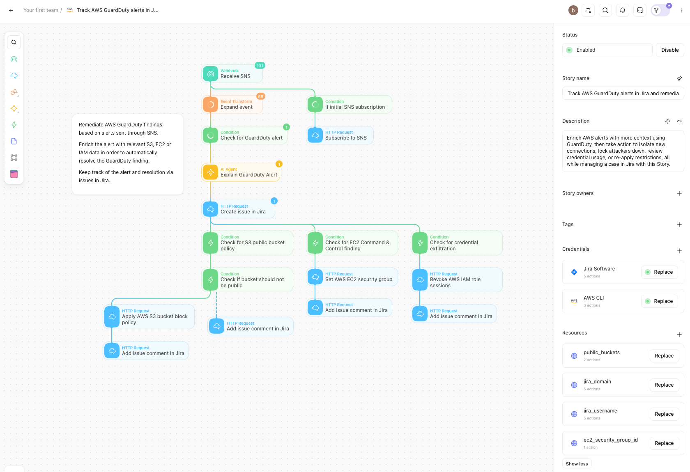
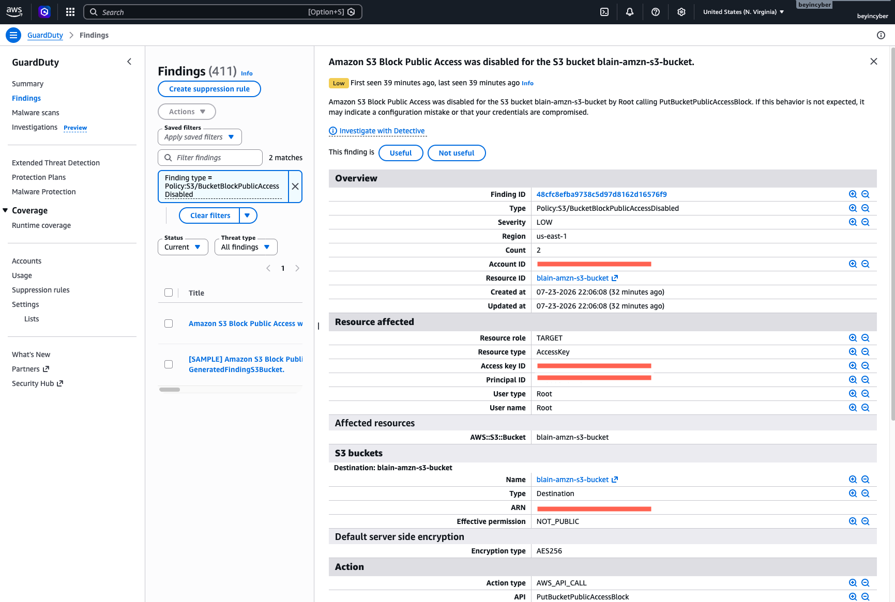
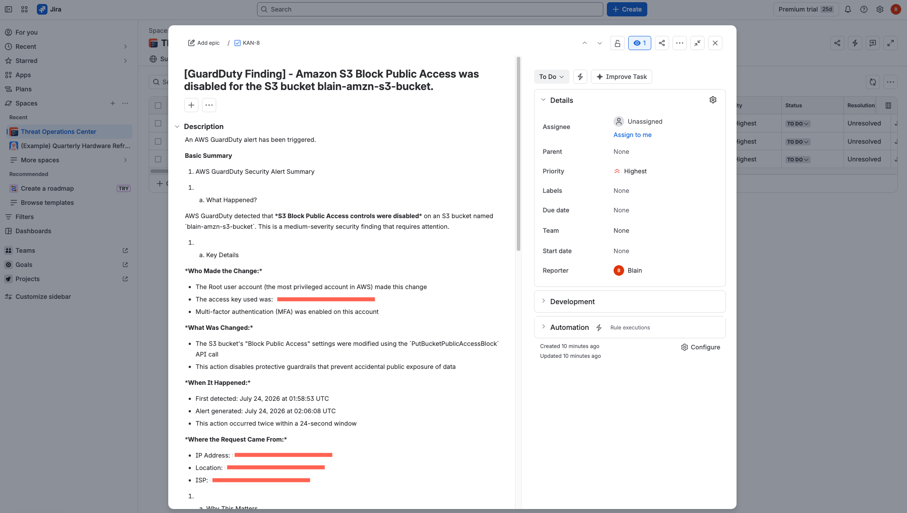
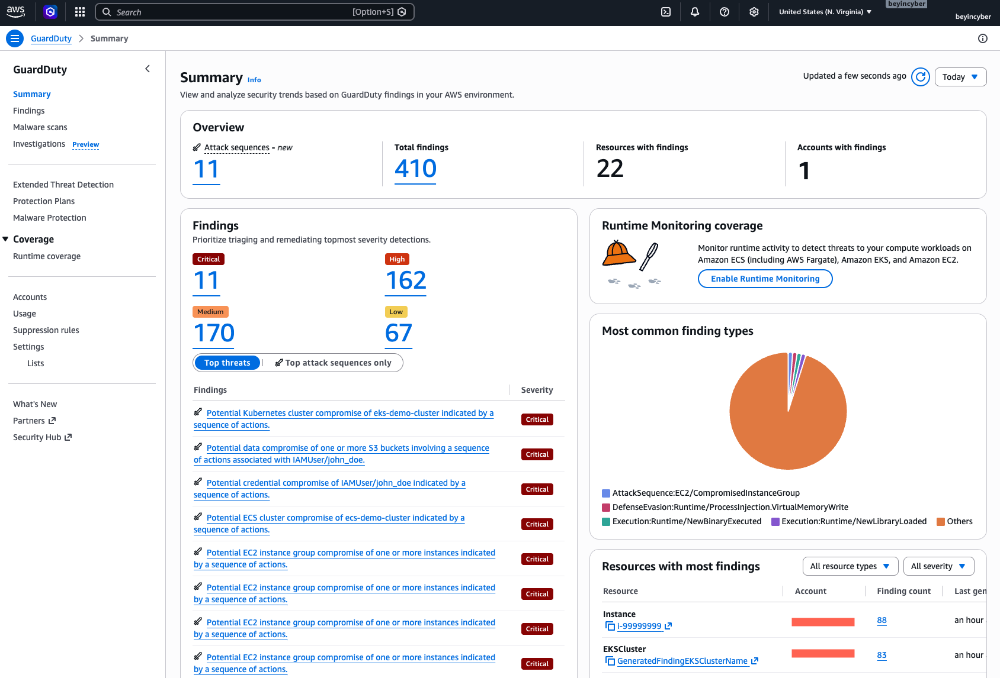

# AWS GuardDuty SOAR Pipeline — Automated Cloud Threat Triage & Remediation

Automated detection-to-remediation pipeline that turns raw Amazon GuardDuty findings into enriched, analyst-friendly Jira cases — and takes real remediation action on the affected AWS resources — using a **Tines** SOAR workflow.

**Stack:** Tines · AWS (GuardDuty, SNS, S3, EC2, IAM) · Jira · AI Agent enrichment

---

## Overview

Security teams drown in cloud alerts. GuardDuty alone can generate hundreds of findings a day (this environment had **410+** active findings across critical, high, medium, and low severities). Manually triaging each one is slow and inconsistent.

This project builds a **Security Orchestration, Automation, and Response (SOAR)** workflow that automates the full lifecycle of a GuardDuty finding:

1. **Detect** — GuardDuty raises a finding, which is published to an SNS topic.
2. **Ingest** — SNS delivers the alert to a Tines webhook.
3. **Enrich** — The event is parsed and passed to an AI agent that generates a plain-English explanation of what happened, who did it, and why it matters.
4. **Track** — A Jira case is automatically created with the enriched context so the finding is visible from detection through resolution.
5. **Remediate** — Based on the finding type, Tines takes targeted action: re-applying S3 Block Public Access, isolating EC2 instances via security groups, or revoking compromised IAM role sessions — then logs each action back to the Jira ticket.

The result is a repeatable pipeline that shrinks the gap between detection and response from *manual and minutes-to-hours* to *automated and near-instant*.

---

## Architecture

```
                 ┌──────────────┐
                 │  AWS Account │
                 │  (GuardDuty) │
                 └──────┬───────┘
                        │ finding published
                        ▼
                 ┌──────────────┐
                 │  Amazon SNS  │
                 └──────┬───────┘
                        │ HTTP POST
                        ▼
        ┌───────────────────────────────┐
        │             TINES             │
        │  ┌─────────────────────────┐  │
        │  │ Webhook: Receive SNS    │  │
        │  │ Expand & parse event    │  │
        │  │ Handle SNS subscription │  │
        │  │ Check for GuardDuty alert│ │
        │  │ AI Agent: explain alert │  │
        │  │ Create Jira issue       │  │
        │  └───────────┬─────────────┘  │
        │              │                │
        │   ┌──────────┼──────────┐     │
        │   ▼          ▼          ▼     │
        │  S3        EC2 C2     Credential│
        │  public    finding   exfiltration│
        │  bucket      │           │     │
        │   │          ▼           ▼     │
        │  Apply     Set EC2     Revoke  │
        │  block     security    IAM     │
        │  policy    group       sessions│
        │   │          │           │     │
        │   └──────────┴───────────┘     │
        │       Comment back to Jira     │
        └───────────────┬───────────────┘
                        │
                        ▼
                 ┌──────────────┐
                 │     Jira     │
                 │ (case mgmt)  │
                 └──────────────┘
```

---

## Workflow Breakdown

The Tines Story is organized into an ingestion phase, an enrichment phase, and three parallel remediation branches keyed off the finding type.

### Ingestion & enrichment
| Step | Action | Purpose |
|------|--------|---------|
| Receive SNS | Webhook | Entry point for SNS-delivered GuardDuty findings |
| Expand event | Event Transform | Flatten and normalize the raw SNS/GuardDuty payload |
| If initial SNS subscription | Condition → HTTP Request | Auto-confirms the SNS subscription handshake |
| Check for GuardDuty alert | Condition | Filters out non-finding traffic |
| Explain GuardDuty Alert | AI Agent | Generates the human-readable summary of the finding |
| Create issue in Jira | HTTP Request | Opens a tracked case with the enriched context |

### Remediation branches
| Finding type | Detection | Response action | Follow-up |
|--------------|-----------|-----------------|-----------|
| **S3 exposure** | Check for S3 public bucket policy → verify bucket should not be public | Apply S3 Block Public Access policy | Comment result to Jira |
| **EC2 command & control** | Check for EC2 C2 finding | Set (isolate via) EC2 security group | Comment result to Jira |
| **Credential exfiltration** | Check for credential exfiltration | Revoke IAM role sessions | Comment result to Jira |

### Credentials & resources used
- **Credentials:** Jira Software, AWS CLI
- **Resources:** `public_buckets`, `jira_domain`, `jira_username`, `ec2_security_group_id`

---

## Screenshots

### 1. Tines SOAR Workflow
The full detection-to-remediation Story: SNS ingestion, AI enrichment, Jira case creation, and three conditional remediation branches.



### 2. GuardDuty Finding
A live finding — `Policy:S3/BucketBlockPublicAccessDisabled` — showing that S3 Block Public Access was disabled on a bucket by the root user via `PutBucketPublicAccessBlock`.



### 3. Auto-Generated Jira Case
The AI-enriched Jira ticket created by the workflow, translating the raw finding into a structured summary: what happened, who made the change, what changed, when, and where the request originated.



### 4. GuardDuty Summary Dashboard
The environment used for validation, with 410+ findings across all severity levels and multiple attack sequences.



---

## Validation & Testing

To prove the pipeline works end-to-end, I generated GuardDuty findings in a controlled AWS environment and traced each event through the workflow:

- **Generated real findings** — including S3 Block Public Access being disabled — and confirmed they flowed from GuardDuty → SNS → Tines → Jira.
- **Traced events** at each stage to verify the payload was parsed and routed correctly.
- **Debugged conditional logic** — identified inconsistencies in the branch conditions that caused certain findings to skip their intended remediation action, and corrected the event-parsing and routing logic so downstream responses fired reliably.
- **Confirmed remediation** — verified that response actions (e.g., re-applying S3 block policy) executed and were logged back to the corresponding Jira case.

---

## Skills Demonstrated

- **SOAR / security automation** — designing and deploying a multi-branch automated response workflow in Tines.
- **AWS security services** — hands-on work with GuardDuty, SNS, S3, EC2, and IAM, including access controls and exposure risks.
- **Event-driven integration** — wiring SNS → webhook ingestion and parsing nested JSON payloads.
- **API integration** — authenticated HTTP requests to the Jira and AWS APIs.
- **Incident management** — mapping detections to trackable cases for full investigation lifecycle visibility.
- **Debugging & validation** — root-causing conditional logic errors and validating a pipeline with real, generated findings.

---

## Repository Structure

```
.
├── README.md
├── images/
│   ├── tines-workflow.png
│   ├── guardduty-finding-s3.png
│   ├── jira-ticket.png
│   └── guardduty-summary.png
└── tines/
    └── story.json          # (optional) exported Tines Story
```

---

## Notes

This project was built in a controlled lab environment for learning and demonstration purposes. All account IDs, access keys, IP addresses, and other sensitive identifiers have been redacted from the screenshots.
